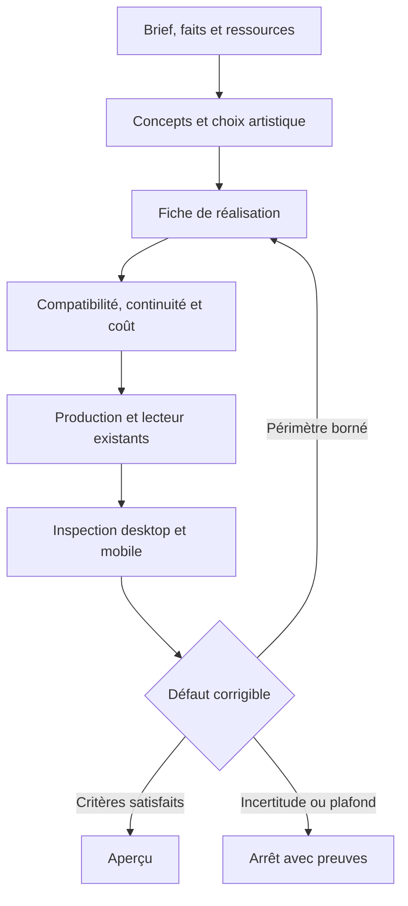

# FABRYA Autonomous Cinematic Director

## Le chemin d'une réalisation



La branche part du commit `21400c3`. Le dossier du premier essai, les commits du lecteur, son code, ses interactions et l'archive Équinoxe contenant le Creative Blueprint restent présents. Le réalisateur s'exécute dans `cinema_factory` et compile sa direction vers le `PLAN` du moteur et le manifeste de lecture déjà déployés.

| Étape | Contrat | Vérification |
| --- | --- | --- |
| Marque et recherche | Public, émotion, valeur, faits, hypothèses, inconnues et authenticité | Le brief et l'historique sont des données. Les destinations sont issues d'une liste de confiance. |
| Invention et arbitrage | Trois ou quatre concepts, point d'entrée, révélation, mécanisme visuel, compromis, valeur et faisabilité | Le modèle sélectionne ou combine et justifie. Un recoupement lexical élevé sur la découverte et le mécanisme bloque les quasi-doublons, y compris avec l'historique fourni. |
| Mise en scène | Sujet et décor, composition, caméra, mouvement propre des sujets, photographie, contraintes et critères de rejet | Les champs structurés sont compilés selon la route et la capacité du modèle. Les éléments non pris en charge comme une caméra numérique restent de la description, utilisable comme intention. |
| Scroll et continuité | Arrêts au début et à la fin de chaque plan, retour, états de raccord, invariants, références et zones clés | Les états et points d'intérêt sont testés contre le recadrage 4:5. Les coupes requièrent au moins un invariant commun. |
| Production | Payload HTTP par fournisseur, sources, paramètres et budget global | Le cycle existant génère, encode et monte. Les références identiques et les requêtes identiques sont réutilisées. Les droits de diffusion restent à valider. |
| Critique et révision | Évaluation indépendante sur des images réelles, défauts avec axe, fait visible, temps, portée et confiance | Le critique reçoit les deux cadrages et des mesures temporelles. La correction ne modifie que la portée justifiée et conserve les preuves. |

Le contrat fourni au modèle limite les routes, les identifiants de médias et les destinations à l'inventaire du projet. Le contrôle de similarité calcule le recoupement des termes, sans utiliser les titres. Une idée reformulée avec un vocabulaire différent peut rester invisible à cette mesure. Le benchmark expose les idées, le choix et la comparaison pour permettre une revue artistique humaine des mécanismes.

## Prompt Engine et fournisseurs

| Route | Enveloppe du moteur | Payload vidéo |
| --- | --- | --- |
| fal Kling 4.0 texte | 720p ou 1080p, 3–24 s, 16:9, 26 000 caractères | `prompt`, `duration`, `resolution`, `aspect_ratio` |
| fal Kling 4.0 image | 720p ou 1080p, 3–24 s. Le cadre suit l'image d'entrée de référence 16:9 | `prompt`, `duration`, `resolution`, `start_image_url` |
| Runway Gen-4.5 texte | 720p, 2–10 s, 1280:720, 1 000 unités UTF-16 | `model`, `promptText`, `ratio`, `duration` |
| Source client | 16:9 autorisé, découpe de la plage sélectionnée | Fichier et empreinte vérifiée, aucun appel vidéo |

Le Kling texte a été démontré en direct sur La Traverse au jalon précédent. Kling image et Runway sont vérifiés contractuellement avec des tests de requête. Les fonctions documentées de fins et de jalons image Kling ne sont pas câblées à la production. Une référence de début commune peut être utilisée pour plusieurs appels Kling image. La continuité entre générations reste à juger sur le film. Les formulations négatives font partie du prompt texte, car les routes activées n'envoient aucun champ négatif non documenté. Le compilateur garde le prompt Kling historique de 1 722 caractères compatible et valide séparément la limite UTF-16 de Runway.

[Schéma Kling texte](https://fal.ai/models/kling/v4/text-to-video/api) · [Schéma Kling image](https://fal.ai/models/kling/v4/image-to-video/api) · [Runway API](https://docs.dev.runwayml.com/api/)

## Inspection et corrections

Pour chaque plan, quatre planches présentent 8 vues dans le cadre source et les mêmes 8 positions dans le cadre mobile. Les variations d'image sont mesurées à 12 vues/s. Le signal photométrique aide à repérer les gels et les changements, avec une limite explicite sur l'inférence du mouvement spatial. La critique image est une requête séparée qui reçoit le brief, la découverte choisie et les observations. Elle ne reçoit pas le prompt complet de production. Le contrat exige une observation pour chacun des huit axes. Le diagnostic de chaque défaut reprend l'axe, le plan et l'horodatage de cette observation.

La boucle accepte zéro à deux corrections. Un problème de cadrage, de découpage ou de contenu commercial peut réutiliser les mêmes vidéos. Une coupe de correction ne peut que réduire la plage existante. Un défaut de prompt, de fournisseur ou de continuité peut autoriser un nouvel appel seulement pour les plans ciblés, dans le plafond. Les défauts de lecteur, les sources incertaines et les diagnostics de confiance faible stoppent la correction payante. Un échec conserve les étapes et les médias déjà produits.

## Offres et plafonds

- **FABRYA Immersive, 59 € TTC/mois.** Le même contrat de marque, d'invention et de choix exporte un traitement adapté aux médias premium et aux interactions légères. `design --offer immersive` fournit une fiche de production. Le moteur vidéo ne produit pas l'offre en images.
- **FABRYA Cinematic, 149 € TTC/mois.** Le contrat complet des plans, du budget et du lecteur est compilé dans le moteur vidéo existant.

Un budget créatif et média hypothétique est utilisable en mode `design`. Un appel facturable exige en plus un plafond explicite en microdollars USD et un relevé opérateur des soldes effectivement consultés. Pour chaque fournisseur, le relevé contient `checked_at` en ISO avec fuseau, `currency` à `USD`, `available_microusd` entier, `automatic_recharge` à `false` et une `verification` sans secret. Le relevé expire en une heure. Il ne lit pas automatiquement une facture ou le solde des comptes fournisseur.

Le registre réserve avant soumission, refuse les doublons exacts au sein d'une exécution, conserve une réservation en cas de réponse incertaine et comptabilise séparément les fournisseurs. Le dossier d'exécution est à usage unique. Un plafond global entre exécutions parallèles ou des dépenses concurrentes sur le même compte exigent un registre partagé ou une coordination opérateur. Les estimations et les jetons d'API restent distincts des débits facturés.

## Commandes locales

```sh
python3 -m unittest discover -s tests -v
python3 scripts/benchmark-director.py --url http://127.0.0.1:18765 \
  --model qwen2.5-7b-instruct-q4 --jobs 2 --out .cinema-runs/director-bench
python3 -m cinema_factory inspect /chemin/master.mp4 \
  --plan docs/essais/la-traverse/plan.json --out .cinema-runs/director-inspect
```

Le benchmark a besoin d'un serveur llama.cpp local avec un modèle préchargé et des sorties JSON structurées. L'inspection fonctionne sans API. Le même mode accepte `--brief`, `--local-url` et `--local-model` pour soumettre les planches à un modèle vision local. Pour l'essai payant, partir d'un brief inédit, appeler `run` avec un nouveau dossier, `--budget-microusd`, `--funds` et les clés du projet autorisé. Repère prudent pour une seule génération Kling 1080p de huit secondes, **2,68 $ maximum réservé** dont 1,88 $ de vidéo et deux réservations OpenAI à 0,40 $. Le coût réel dépend du plan, des jetons et de la route. Cette réservation ne répond pas aux éventuelles corrections supplémentaires.
