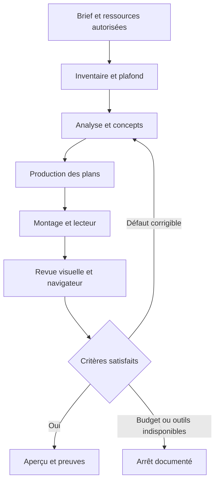

# FABRYA Autonomous Cinematic Website Factory

## Continuité

Le `main` GitHub observé le 19 novembre 2026 est `192bf0d2977ff07a9c34fa9a483a86f5b2dfd275`. Le commit `9c2f1197e023e6429a07e85587236004880d2508` est issu du bundle « Au tour », branche `experiment/gestes-cinema`, descendante de ce `main`. Le travail prolonge ce commit sur `experiment/autonomous-cinema`. Le ZIP Équinoxe et les essais historiques restent dans l'historique. Le lecteur réutilise la même progression native, le même cache WebP, le même décodage réversible et le même mode de mouvement réduit. Il accepte maintenant plusieurs repères successifs et des accès directs. Le HTML et le manifeste historiques restent compatibles.

## Parcours d'exécution



| Étape | Contrat entrant | Résultat persistant |
| --- | --- | --- |
| Analyse et choix créatif | Brief texte, ressources autorisées et capacités accessibles, budget restant, critiques précédentes | `plan.json` selon `contracts.PLAN`, faits, inconnues, concepts, choix motivé, continuité, action métier, route et résolution par plan |
| Production et coût | Plans validés, options connues des adaptateurs, réservation avant chaque appel | Fichiers sources, images de référence éventuelles, empreintes et droits dans `journal.json`, identifiants fournisseur et estimations dans `costs.json` |
| Montage | Plans vidéo 16:9, points d'entrée, durées entières et définition | Master H.264 24 i/s, coupes franches, contrôles d'images figées et noires sur toute la séquence, `film.json` |
| Site | Master, fenêtre mobile et repères temporels, destinations confirmées | Deux profils de diffusion desktop et mobile, plafonnés à 6 Mo et 3 Mo, chacun découpé en paquets WebP de 24 vues, posters prioritaires et manifeste `track.json` |
| Contrôle | Site assemblé et master | Mesures Chromium, captures desktop et tactile émulé, échantillons visuels avant/après chaque raccord, verdicts séparés dans `artistic-review.json` |
| Correction et livraison | Défaut documenté ou contrôle réussi | Nouvelle tentative bornée, réutilisation des ressources inchangées, ou `delivery.json` pointant vers l'aperçu et ses preuves |

Les repères ont un intervalle en secondes dans leur plan et des coordonnées normalisées dans le master. L'assemblage les convertit en index entiers et refuse un repère tronqué sur mobile. L'interface affiche un repère à la fois. Les actions ont un accès direct et peuvent ouvrir une fiche locale ou pointer vers une URL confirmée. Aucune soumission native ni création de commande n'est prévue dans cette version. Les URLs sont résolues à partir d'un inventaire contrôlé hors du brief. Le moteur d'assemblage traite les champs de modèle comme du texte et n'exécute aucune commande produite par celui-ci.

L'agent choisit parmi les routes réellement activées. Il peut combiner des plans générés et des plans client. Le montage ne dépasse ni la définition la plus basse retenue dans le plan ni celle des sources. La définition encodée et la provenance sont journalisées séparément. Les méthodes non raccordées sont la 3D photoréaliste, le suivi dynamique d'objet, l'interpolation de mouvement et les transitions autres que la coupe. Le recadrage mobile est horizontal et fixe. Le format de diffusion est muet et le profil actuel est limité à quatre plans et 24 secondes. La mise en ligne commerciale exige encore une validation des droits et des essais sur appareils physiques.

### Fournisseurs et accès

| Route | Capacité documentée et implémentée | État dans cet environnement |
| --- | --- | --- |
| OpenAI | Responses API, `gpt-6.1-sol`, JSON structuré pour la création, images échantillonnées pour la revue | API joignable, réponse HTTP 401 sans clé. `OPENAI_API_KEY` absente. Aucun appel de génération exécuté |
| fal | Kling v4 texte-vers-vidéo et image-vers-vidéo, 720p/1080p. Le chemin de référence produit une image FLUX puis un vrai plan Kling. File d'attente REST | Compte connecté dans ChatGPT, catalogue et schémas lus. `FAL_KEY` absente du processus. Aucun crédit testé ou consommé |
| Runway | Gen-4.5 texte-vers-vidéo, 720p, 2 à 10 s. Tâche REST, récupération du média et attribution dans le site assemblé | API joignable, réponse HTTP 401 sans clé. `RUNWAYML_API_SECRET` absente. Aucun appel de génération exécuté |
| Fichiers client | Fichiers locaux, licence et empreinte, découpe et production à partir de vidéo réelle | Route exécutée sur le film « Au tour » |
| Veo 3.1 / Kling 3.0 4K | Alternatives tarifées à évaluer selon rendu, droits et API | Catalogue comparé. Adaptateurs non intégrés, aucun test avec ces modèles |

Les routes facturables sont fermées par défaut. Injecter les clés **des projets fournisseurs existants** depuis le gestionnaire de secrets du runtime ou du Codespace, dans le seul processus de travail. Conserver le crédit et l'autorisation de dépense au niveau du projet, vérifier que le rechargement automatique est désactivé, puis passer un plafond approuvé **par exécution** en microdollars USD. Vérifier le tarif courant du modèle avant ouverture de la facturation. Le journal conserve la réservation d'un appel dont le résultat est incertain. Consulter le résultat par l'identifiant sauvegardé avant tout renvoi et rapprocher le montant estimé de la facture fournisseur. L'exécution résout le budget au niveau du dossier de travail. Un plafond global entre plusieurs travaux simultanés exige un registre transactionnel séparé.

### Reproduction

Prérequis locaux. Python 3.12, FFmpeg avec libx264 et libwebp, Node, Playwright et Chromium ou Chromium Headless Shell. Utiliser `CHROMIUM_BIN` pour choisir l'exécutable. Installer Playwright dans l'environnement Node du dépôt ou fournir le répertoire de modules du runtime via `CODEX_PRIMARY_RUNTIME_NODE_MODULES`.

```sh
python3 -m cinema_factory doctor
python3 -m unittest discover -s tests -v
python3 -m cinema_factory run briefs/cinema/optique.md --out .cinema-runs/optique
python3 -m cinema_factory run briefs/cinema/reliure.md --out .cinema-runs/reliure
```

Ces invocations à plafond nul montrent le contrôle des prérequis. En exécution autorisée, ajouter `--budget-microusd` avec le plafond approuvé, et un nouveau dossier de sortie. Les clés et la configuration de budget restent hors du brief et du dépôt. L'option `--assets` charge un fichier JSON contenant des entrées `id`, `file` (chemin relatif adjacent), `description` et `rights`. L'option `--destinations` charge une table d'IDs vers des URL HTTPS, mailto ou tel confirmées.

```sh
python3 -m cinema_factory assemble tests/fixtures/au-tour-brief.md \
  --plan tests/fixtures/au-tour-plan.json --assets /chemin/vers/assets.json \
  --out .cinema-runs/au-tour
python3 -m http.server 8000 --directory .cinema-runs/au-tour/attempt-1/web
```

Ce deuxième mode importe un plan explicite, monte et encode le film, vérifie les gestes et exporte les preuves. Son aperçu est technique. L'exécution autonome n'accepte aucun plan fourni en entrée.

## Économie de l'abonnement

Avec l'hypothèse d'une TVA au taux normal de 20 %, 59 € TTC correspondent à 49,17 € HT. Les projections ci-dessous utilisent un taux de conversion **supposé** de 0,92 €/USD, 30 €/h de travail humain et des révisions comptées dans la durée générée. Elles ne constituent pas des dépenses observées.

| Scénario | OpenAI estimé | Images et vidéo | Calcul montage et QA | Travail humain | Production totale |
| --- | ---: | ---: | ---: | ---: | ---: |
| 24 s HD, 8 s de reprise | 0,30 $ | 7,53 $ dont quatre références FLUX et 32 s Kling v4 1080p | 0,50 $ | 7,50 € | **15,17 €** |
| 24 s UHD, 8 s de reprise, modèle externe catalogue | 0,30 $ | 13,76 $ pour 32 s Kling 3.0 4K chez Runway | 0,80 $ | 15,00 € | **28,67 €** |
| 24 s premium, 40 s de reprises | 0,50 $ | 96,00 $ pour 64 s Seedance 2.0 4K chez Runway | 1,50 $ | 22,50 € | **112,66 €** |

Service mensuel estimatif à **8,51 € par site**. Scénario de 0,25 Go sur R2 Standard, 4 000 lectures et 30 écritures mensuelles coûtant environ 0,0053 $ avant palier gratuit, 1,25 € de quote-part d'exploitation, 3,75 € de support, 1,50 € de provision paiement et 2 € de réserve pour une mise à jour. Le modèle ne provisionne ni acquisition, ni impayés, ni TVA fournisseur, ni régénération lourde. L'interpolation est absente des trois scénarios. À coût mensuel constant, le premier mois conserve environ 25,49 € en HD, 11,99 € en UHD maîtrisée et un déficit de 72,00 € en premium. Une seule séance de nouvelles générations peut changer l'économie. La demande d'un site premium à 59 € TTC requiert une limite par projet ou une durée de rétention suffisante, à établir sur des factures et temps observés.

## Passage au commercial sous validation du fondateur

1. Raccorder les secrets des projets existants et autoriser un plafond distinct pour les deux essais. Observer les premiers débits et leur rapprochement avec les réservations.
2. Exécuter les deux briefs sans storyboard. Contrôler les plans complets sur écrans physiques et réseaux ralentis, l'exactitude des interactions et les droits des médias. Comparer le verdict de l'agent à l'observation humaine sur les raccords et la stabilité image par image.
3. Stabiliser la reprise des tâches fournisseur par ID, le budget global et les coûts d'exploitation. Ajouter la 3D, l'interpolation ou l'UHD générée uniquement sur besoin constaté et après validation de leur apport au rendu.
4. Tester une livraison sous domaine privé avec une destination commerciale confirmée et le suivi d'aboutissement. Valider une marge par projet sur des coûts facturés avant tout déploiement commercial.

## Sources fournisseur et tarif

- [OpenAI GPT-6.1 Sol](https://developers.openai.com/api/docs/models/compare?model=gpt-6.1-sol)
- [fal Kling 4.0](https://fal.ai/models/kling/v4/text-to-video), [image vers vidéo](https://fal.ai/models/kling/v4/image-to-video), [FLUX Schnell](https://fal.ai/models/fal-ai/flux/schnell), [queue](https://fal.ai/docs/documentation/model-apis/inference/queue), [facturation](https://fal.ai/docs/documentation/model-apis/pricing) et [conditions](https://fal.ai/legal/terms-of-service)
- [Runway API](https://docs.dev.runwayml.com/api/), [tarifs](https://docs.dev.runwayml.com/guides/pricing/), [attribution](https://docs.dev.runwayml.com/usage/attribution/) et [rechargement](https://docs.dev.runwayml.com/usage/autobilling/)
- [R2 Standard](https://developers.cloudflare.com/r2/pricing/) et [TVA française](https://www.economie.gouv.fr/entreprises/gerer-sa-fiscalite-et-ses-impots/autres-impots-et-taxes/entreprises-ce-que-vous-devez-savoir-sur-la-tva)

## Lecteur cinématographique réutilisable

La méthode issue du [lecteur Hélior](https://github.com/sempehugo03-jpg/fabrya-immersion-factory/blob/577e3d3/sites/helior-cinematic/film-player.js) est intégrée dans les sorties ordinaires de `python -m cinema_factory run` et `assemble`. Le lecteur reçoit des images WebP indépendantes. Chaque paquet contient une concaténation d'images WebP et le manifeste donne les limites de chaque image en octets. Un poster séparé s'affiche pendant le chargement. La génération actuelle conserve le master de production à 24 i/s et n'ajoute pas d'images intermédiaires.

Pour une intégration dans un site existant, importer `createFrameLoader` depuis `frame-loader.js`, choisir un profil de `track.json`, puis appeler `seek(index)` avec l'index obtenu à partir de la position de scroll. La fonction `onFrame(index, bitmap)` reçoit la vue à peindre. Le lecteur conserve et libère les bitmaps, que le site doit peindre pendant le rappel. Transmettre des callbacks `onError`, `isPaused` et `conserveData`. Appeler `dispose()` avant un changement de profil ou au démontage du module. L'export fourni contient un exemple avec clavier, tactile, mouvement réduit et actions accessibles séparément du film.

Le lecteur charge d'abord le paquet demandé et anticipe dans le sens du geste. Il retire les demandes devenues inutiles et borne les caches. Le geste positionne directement le film, conformément au cahier des charges FABRYA qui demande un arrêt sans inertie ajoutée. Le double amorti et le fondu du prototype Hélior relèvent de réglages propres à cet essai. Pour évaluer leur apport sur un prochain site, mesurer également le délai de stabilisation et inspecter les transitions sur l'appareil cible.

Le réalisateur choisit le sujet, le mouvement, les interactions et la composition mobile en fonction du brief. L'examen de la source à vitesse constante précède le jugement de fluidité au scroll. Contrôler les raccords, les grands sauts, les inversions, le retour et l'arrêt sur le même export. Les tests locaux ne suffisent pas à qualifier le rendu sur un téléphone physique ou à valider la qualité de la direction artistique.
